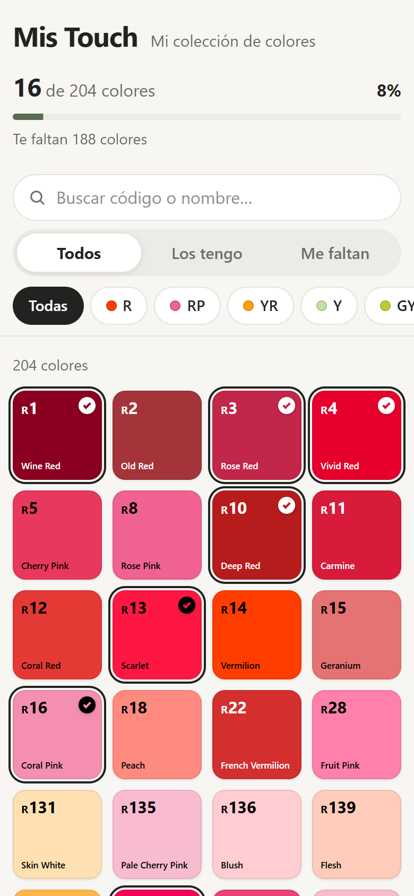

# Mis Touch

**Una app liviana para llevar el registro de tu colección de marcadores TOUCH Twin:** tocás un color y queda marcado como "lo tengo". Funciona en el teléfono, se instala como app y sigue andando sin internet.

> *English:* Mis Touch is a tiny offline-first PWA to track which of the 204 ShinHan TOUCH Twin marker colors you own. No backend, no tracking: your collection stays on your device. The UI is in Spanish; contributions are welcome in Spanish or English.

<p align="center">
  
</p>

[](https://github.com/OWNER/REPO/actions/workflows/ci.yml)


---

## Qué hace

- **Muestrario de los 204 colores** de la línea TOUCH Twin, cada uno con su código, número, nombre y color.
- **Un toque para marcar** "lo tengo" o "me falta". El color nunca se atenúa: lo marcado se distingue con un check y un borde.
- **Progreso de la colección**: cuántos tenés, cuántos te faltan y el porcentaje.
- **Búsqueda** por código, número o nombre (sin importar mayúsculas ni acentos; acepta `0,5` o `0.5`).
- **Filtros combinables**: `Todos`, `Los tengo`, `Me faltan` y por familia (R, RP, YR, Y, GY, G, BG, B, PB, P, BR, CG, WG, GG, F y sin familia).
- **Funciona sin conexión** después de la primera carga.
- **Copia de seguridad**: exportás e importás tu colección como un archivo JSON.
- **Privada**: no hay cuentas, servidores, analíticas ni rastreadores. Todo se guarda en tu dispositivo.

## Usarla

### Desde el navegador

Abrí **[marcadorestouchcheck.netlify.app](https://marcadorestouchcheck.netlify.app)** en cualquier navegador moderno. También podés publicar tu propia copia: ver [Publicar tu propia copia](#publicar-tu-propia-copia).

### Instalarla en Android (recomendado)

1. Abrí el enlace en **Chrome**.
2. Esperá el aviso *"Listo: Mis Touch ya funciona sin conexión"*.
3. Tocá **Instalar app** en el aviso de Chrome o, si no aparece, menú **⋮ → Instalar aplicación**.
4. Abrila desde el ícono: se ve en pantalla completa, como cualquier app.

También existe la opción de un `.apk` que envuelve la misma app web; ver [docs/DEPLOYMENT.md](docs/DEPLOYMENT.md#paquete-android-apk-opcional).

### iPhone / iPad

En Safari: botón **Compartir → Agregar a pantalla de inicio**. *(No probado en dispositivos iOS reales.)*

### Tus datos

- La colección vive **solo en ese navegador de ese dispositivo**. No se sincroniza entre teléfonos.
- Si borrás los datos del navegador, desinstalás la app o cambiás de teléfono, se pierde.
- Usá **Exportar copia** de vez en cuando (al final de la página) y guardá el archivo. Con **Importar copia** la recuperás en cualquier dispositivo.

## El catálogo

El catálogo tiene **204 colores**. Se genera a partir de una lista de origen que no se modifica, más un archivo de correcciones donde cada cambio cita su fuente. Los colores en pantalla son **aproximaciones digitales**, no valores oficiales del fabricante: pueden diferir de la tinta real según la pantalla.

Detalles, fuentes y cómo proponer una corrección: [docs/DATA_CATALOG.md](docs/DATA_CATALOG.md).

## Desarrollo

### Requisitos

- [Node.js](https://nodejs.org/) `22.18+` o `24+` (hay un `.nvmrc`).
- npm (viene con Node).

### Puesta en marcha

```bash
git clone https://github.com/OWNER/REPO.git
cd REPO
npm install
npm run dev
```

Abrí la URL que muestra la terminal (por defecto `http://localhost:5173`).

### Comandos

| Comando | Qué hace |
|---|---|
| `npm run dev` | Servidor de desarrollo con recarga en vivo. |
| `npm run typecheck` | Verificación de tipos con TypeScript. |
| `npm run test` | Pruebas unitarias (Vitest). |
| `npm run build` | Typecheck + build de producción en `dist/`. |
| `npm run preview` | Sirve `dist/` localmente (agregá `-- --host` para abrirlo desde el teléfono en la misma red). |
| `npm run catalog` | Regenera `src/data/touch-colors.json` desde la fuente y las correcciones. |
| `npm run icons` | Regenera los íconos PNG de la app. |

> **Windows / PowerShell 5:** `&&` no funciona; ejecutá los comandos de a uno.

### Stack

Vite · TypeScript · HTML y CSS sin frameworks · [vite-plugin-pwa](https://vite-pwa-org.netlify.app/) (Workbox) · Vitest. Sin dependencias en tiempo de ejecución propias: el JS final pesa unos 12 kB comprimido.

### Estructura

```text
data/
  source/touch-colors-original.csv   lista de origen (inmutable)
  catalog-corrections.json           correcciones con fuentes
scripts/
  build-catalog.mjs                  genera el catálogo derivado
  generate-icons.mjs                 genera los íconos (sin dependencias)
src/
  catalog.ts                         parseo, construcción y validación del catálogo
  filter.ts                          búsqueda, filtros y progreso (funciones puras)
  inventory.ts                       localStorage y copias de seguridad
  contrast.ts                        contraste WCAG para el texto sobre cada color
  main.ts                            interfaz (DOM nativo)
  style.css                          estilos
  data/touch-colors.json             catálogo generado (no editar a mano)
public/                              íconos, cabeceras y archivos estáticos
tests/                               pruebas unitarias
docs/                                documentación del proyecto
```

Más detalle en [docs/ARCHITECTURE.md](docs/ARCHITECTURE.md).

## Publicar tu propia copia

La app es un sitio estático: cualquier hosting con HTTPS sirve (Netlify, Cloudflare Pages, GitHub Pages…). Con `npm run build` se genera `dist/`, que es lo que se publica. Paso a paso y particularidades de cada servicio en [docs/DEPLOYMENT.md](docs/DEPLOYMENT.md).

## Contribuir

¡Bienvenidas las contribuciones! Leé [CONTRIBUTING.md](CONTRIBUTING.md) antes de abrir un pull request. Para errores en el catálogo (un nombre, código o color equivocado) hay una plantilla de issue específica: siempre pedimos una fuente.

## Documentación

| Documento | Contenido |
|---|---|
| [docs/PRODUCT_SPEC.md](docs/PRODUCT_SPEC.md) | Qué es el producto, alcance y reglas de negocio. |
| [docs/UX_UI.md](docs/UX_UI.md) | Lineamientos visuales y de accesibilidad. |
| [docs/ARCHITECTURE.md](docs/ARCHITECTURE.md) | Módulos, modelo de datos, persistencia y PWA. |
| [docs/DATA_CATALOG.md](docs/DATA_CATALOG.md) | Origen del catálogo, correcciones y fuentes. |
| [docs/TESTING.md](docs/TESTING.md) | Pruebas automáticas y checklist manual. |
| [docs/DEPLOYMENT.md](docs/DEPLOYMENT.md) | Publicación, actualizaciones y paquete Android. |
| [docs/DECISIONS.md](docs/DECISIONS.md) | Registro de decisiones de diseño (ADR). |
| [docs/ROADMAP.md](docs/ROADMAP.md) | Estado actual e ideas a futuro. |
| [CHANGELOG.md](CHANGELOG.md) | Cambios por versión. |

## Licencia y aviso

Código bajo licencia [MIT](LICENSE).

Proyecto independiente y sin fines comerciales. **No está afiliado ni respaldado por ShinHan Art.** "TOUCH" y "ShinHan Art" son marcas de sus respectivos titulares y se mencionan solo para identificar los productos. Los nombres y códigos de colores se usan con fines descriptivos.
